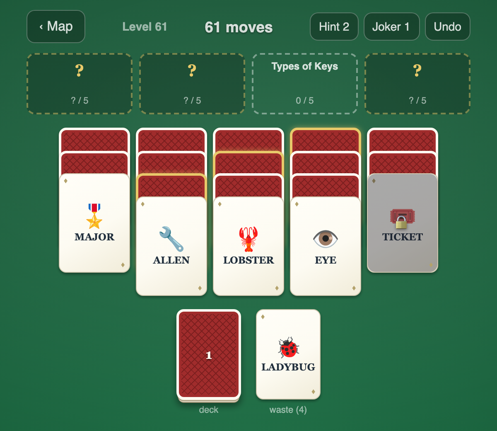
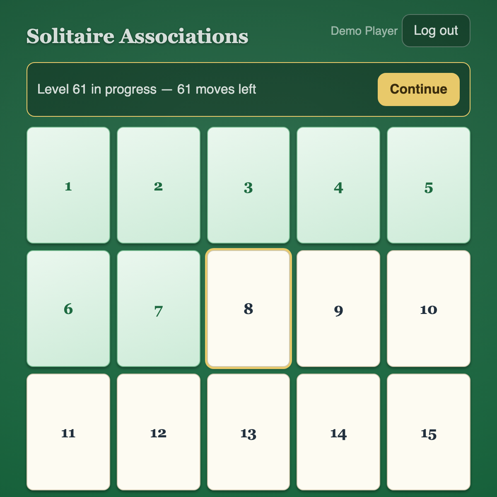

# Solitaire Associations

A browser version of the iPhone word-solitaire game Solitaire Associations
Journey. Instead of suits and ranks, every card is a word, and every word
belongs to exactly one of four hidden categories. You clear a level by
sorting all the words into their categories before you run out of moves.

It is a personal project: a gameplay-only clone with no ads, coins or
purchases, playable on any device with a browser. It runs as a small
FastAPI app with a plain JavaScript frontend, 150 generated levels, user
accounts and saved progress.





## How the game plays

Word cards are dealt into tableau columns plus a draw deck. Place accessible
cards into the right category before the move budget runs out. Hints reveal
a card's category, jokers auto-place a card, undo refunds the last move.
Whole face-up stacks can be moved onto empty columns, like the base game.

Two mechanics from the original ride on top of that core:

- **Gold cards**: categories start hidden ("?" slots). Each has a gold
  "ace" card buried in the first four tableau columns; uncovering it flies
  it to its slot for free and reveals the group. Words can only be placed
  into revealed slots.
- **Lock and key**: from level 61, the top card of a column past the gold
  columns is padlocked and unplayable. Its key is a normal word card
  (marked with a key badge) elsewhere in the deal; correctly placing the
  key breaks the lock.

Both are dealt so they cost a perfect player zero extra moves (golds are
auto-collected free and chained under already-placeable covers; the key's
placement is a scoring move it needed anyway), which keeps the budget
formula and the winnability guarantees below untouched.

Game state autosaves after every move (debounced, `sendBeacon` on tab
close). There is no save/load UI: reload resumes exactly. Levels are
playable in any order; the map highlights the first one not yet completed.

### Reference game and scope

The game being emulated is Solitaire Associations Journey by Hitapps Games
(App Store id 6748950306). Implemented: core tableau/stock/categories, hints,
jokers, undo, move budget, gold-border cards that reveal hidden categories
(`golds: true`, budget-neutral deal), lock and key cards (`locks` knob, level
61+, key is a normal word card). Deliberately not implemented: coins, lives,
ads, extra-move purchases, events, daily challenges, journey map theming, and
wild multi-category cards (they would break the save-state word-multiset
validation). Gameplay only, by decision.

## Difficulty

150 levels. Card count steps up by tier (16 / 20 / 20 / 24 / 28 cards at
difficulty 1-5), but the *pressure* ramps on level id, so a level also gets
harder within its tier rather than only at the 31/61/91/121 boundaries.
`curve()` in `gen_levels.py` is the single knob; it bakes these fields into
each level in `data/levels.json`:

| field | level 1 | level 150 |
| --- | --- | --- |
| `move_budget` | 3.5x a perfect solve | 1.27x |
| `tableau_frac` | 60% of the deck dealt face-down | 90% |
| `hints` / `jokers` | 3 / 1 | 0 / 0 |
| `locks` | 0 (first lock at level 61, two from 91) | 2 |

Every level also carries `golds: true`; the engine caps `locks` at
columns - 4 so locks never collide with the gold columns.

A perfect solve is one placement per card plus one draw per stock card, so
the budget is never below it. `tests/test_engine.mjs` plays all 150 levels
with full knowledge on 5 seeds each and asserts every one is winnable.
`tests/test_levels.py` asserts the curve is monotonic: no level may offer
more slack, deeper hints, or a shallower tableau than the level before it.

Re-tune by editing `curve()` and running `python3 gen_levels.py`, which
rewrites `data/levels.json` deterministically from the quad bank above it.
`engine.js` falls back to the old flat values (60% / 3 / 1, no golds, no
locks) for any level missing the fields, and old saved games without the
gold/lock fields still resume.

## Architecture

```
browser -> this app (cookie session) -> PostgREST (Bearer JWT, RLS) -> Postgres
```

- **FastAPI** app (`app/main.py`) serving a vanilla-JS frontend
  (`app/static/`), port 8790. The API covers login/logout, the level list
  and level detail, game state, level completion, and `/api/health`.
- Game logic is a pure ES module (`app/static/engine.js`): deterministic
  given (level, seed), fully serializable, tested under node.
- **Own schema `solitaire`** in a shared `apps` Postgres database. All game
  data goes through a shared **PostgREST** (`Accept-Profile: solitaire`, RLS
  keyed on the JWT `user_id` claim). The only direct-DB paths are the same
  ones every sibling app has: startup bootstrap, per-request session checks,
  and the account CLI.
- **Accounts**: argon2id hashes, lowercase usernames, no self-signup.
  Password verification is delegated to a shared **postgrest-auth** service
  (`POST /token` with schema `solitaire`; timing-safe, legacy bcrypt
  rehashed on login, 5-failure/15-minute lockout per user and per IP).
  The HS256 JWT it mints with the shared PostgREST secret
  (`role: solitaire_user`) is both the session cookie and, forwarded
  verbatim, the PostgREST Bearer token (`app/auth.py`). Sessions last 30
  days and are revoked by `password_changed_at`, so a password change,
  disable or re-enable logs the user out.

## Running it

Requirements: Python 3.13 and [uv](https://docs.astral.sh/uv/); node for the
engine tests. A full setup also needs Postgres, PostgREST and the
postgrest-auth service.

```
uv sync
uv run uvicorn app.main:app --port 8790
```

Configuration is read from the environment, or from `.env` in the repo root
for a bare local run (see `.env.example`): `APP_SCHEMA`, `POSTGREST_URL`,
`AUTH_URL`, `POSTGRES_URL` / `POSTGRES_PORT` / `POSTGRES_DB` /
`POSTGRES_USER` / `POSTGRES_PASSWORD`, `POSTGREST_JWT_SECRET` (must equal
the PostgREST JWT secret; `JWT_SECRET` is accepted as a fallback name), and
optionally `SOLITAIRE_LEVELS_PATH` to override `data/levels.json`.

Without the database and the auth service the app still starts and serves
the login page, the level list and a degraded `/api/health`, but nobody can
log in, so levels cannot be played or saved.

The `Dockerfile` builds the same app with `uvicorn` on port 8790.

### Schema bootstrap

`app/bootstrap.py` converges the schema at startup (Book-Bot pattern):
version-gated via `solitaire.deploy_meta`, additive-only SQL in `deploy/`,
`NOTIFY pgrst, 'reload schema'` at the end. It expects the shared
`postgrest_authenticator` and `web_anon` roles to exist already, and logs
and keeps serving if it fails (the next boot retries). The docker entrypoint
is inert. Manual run: `uv run python scripts/init_db.py [--force]`.

### Accounts

```
docker compose -f docker_compose_projects.yaml exec solitaire-web \
    python -m app.users_cli <add|list|passwd|role|disable|enable|remove> ...
```

Accounts are created only through that CLI. There is no self-signup and no
import path: this app never reads another app's storage, and no importer
from any other app's data will be reintroduced.

### Deploy

Standard federation: the compose fragment in `deploy/` is `include:`d by
`Docker/docker_compose_projects.yaml`; the schema is listed in
`PGRST_DB_SCHEMAS`; `git_pull.sh` maps `Solitaire_Associations` to
`solitaire-web`; a SWAG reverse proxy forwards the public subdomain to
`solitaire_web:8790`. Push to master and the home server's cron job pulls
and redeploys.

## Card art

`data/word_emoji.json` maps every level word to an emoji (or null).
`scripts/fetch_emoji_assets.py` syncs the referenced Noto Emoji SVGs into
`app/static/img/emoji/` (committed; see `licenses/`). The backend injects
per-level `icons` ids; unmapped words get a procedural monogram medallion
client-side. After editing levels or the mapping, rerun the fetch script:
`tests/test_icons.py` fails if any mapped glyph is missing from disk.

## Tests

```
uv run pytest                      # python: auth, levels, real-DB account roundtrip
node --test tests/test_engine.mjs  # engine
```

DB-backed tests hit the real database and go red when it is unreachable,
never skipped.

## License

MIT (`LICENSE`). Emoji artwork is Noto Emoji, under its own license in
`licenses/`.
